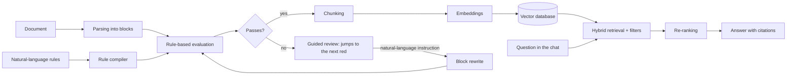

# SDD: Document quality traffic light for RAG

Status: **v1.0, decisions closed** · 2026-10-11 · Author: Luciano Balbiano

Design document for the lab's capstone project. It defines what gets built, how, and
**why**, and writes down the open questions before touching any code.

**Changes in v0.2**: zero cost as a hard constraint; our own local evaluator instead of Jev;
LLMs through free tiers with a local fallback; documents that don't pass are not indexed; navigation
by errors; proposed subject matter and rules; public repo.

---

## 0. Project constraints

1. **Zero cost, or as close as possible.** This is research. Everything that can run locally
   on the M4 MacBook runs locally. Whatever needs a large model goes through API *free tiers*,
   with a local model as a fallback.
2. **Every piece is understood.** Each stage is built **by hand first** (the minimal version
   that shows the mechanism) and **then with the library** used in industry, and the
   two are compared. See §1.
3. **Public repo, MIT license.** Only public documents, nothing from the original interview, no keys
   in the code. The corpus is versioned as a list of URLs plus a download script, not
   as files.

## 1. How learning happens in this project

The project is the excuse; the goal is to understand how software is built with LLMs today.
Every lab follows the same path, and its README writes it down:

| Step | What is done | Example (vector database) |
|---|---|---|
| 1. Concept | What problem it solves, in one page | Finding "the most similar" among millions of vectors without comparing them all |
| 2. By hand | The minimal version in pure Python or numpy | Cosine similarity against everything; then a toy HNSW |
| 3. With the library | The real tool and what it does for us | Qdrant: index, filters, persistence, quantization |
| 4. Measurement | A number that compares 2 and 3 | Recall@10 and latency: exact vs HNSW vs Qdrant |
| 5. Note | What I learned, in `notes/` | When each one makes sense and which parameters matter |

Dependencies come in at the lab where they are first used, with one line on what
they solve and which alternative was discarded.

## 2. The problem

A semantic search engine (RAG) answers only as well as what it has indexed. In practice:

- People upload documents every day and don't know which ones will be useful to the assistant.
- There is information a person sees and the model doesn't: a table with a dark background and red
  text is obvious to a human and, after extracting the text, it is just another paragraph (or nothing).
- When the assistant answers badly about a poorly indexed document, the blame falls on the
  assistant ("it's useless"), not on the document.

The idea: **evaluate each document before indexing it**, show in a traffic light which parts
are fine (green), doubtful (yellow) or bad (red), and **guide the person through each
problem** to fix it in natural language. A document enters the index only when
it passes the rules.

## 3. Goals

### Product
1. Upload a document (`.md`, `.pdf`, `.docx`, `.pptx`, `.html`) and see the traffic light per block
   (paragraph, table, heading).
2. Rules are written **in natural language** and are configurable: 5, 20 or 50, as many as
   needed. They are data, not fixed fields.
3. **Nothing is indexed until it passes.** Fixing has to be fast: the UI jumps from one
   problem to the next and at each one asks what to change, in natural language.
4. Index the approved document and talk to the corpus through a chat, with citations.

### Learning
1. **Vector databases in depth**: embeddings, distances, indexes (HNSW), metadata
   filters, hybrid search, quantization.
2. **Document processing**: from a file to structured blocks, from blocks to
   chunks, from chunks to vectors, and back again with retrieval.
3. **What surrounds the model**: evals, calibration, guardrails, permissions, cost and latency.
4. **Professional Python**: FastAPI, Pydantic, async, pytest, and understanding each library.

### Non-goals (for now)
- Real multi-user support, authentication or deployment.
- Editing the original file. The corrected version is stored as structured text.
- Scanned documents (OCR) and images.
- A pretty UI. It has to be simple, fast and work.

## 4. End-to-end flow



| # | Subsystem | Input → output | What is learned |
|---|---|---|---|
| 1 | Ingestion and parsing | file → blocks with type, text, position and section | what a PDF looks like inside, layout, tables |
| 2 | Rules | free text → typed, versioned questions | structured output, validation, prompts |
| 3 | Evaluator (traffic light) | blocks × rules → level + confidence | logprobs, classification, calibration |
| 4 | Guided review | block + instruction → new block, re-evaluated | controlled generation, guardrails |
| 5 | Indexing and RAG | approved blocks → chunks → vectors → answers | embeddings, indexes, retrieval, re-ranking, evals |

## 5. Design by component

### 5.1 Ingestion and parsing

**What it does.** Turns the file into a list of **blocks**: the unit that is evaluated,
shown in the UI and fixed.

```python
class Block:                 # src/llm_lab/blocks.py
    kind: str                # "heading" | "paragraph" | "list_item" | "table"
    text: str
    level: int               # headings only: 1 is the highest
    page: int | None
    rows: list[list[str]]    # tables only; the first row is the header
    links: list[Link]        # text and URL of each link
    path: list[str]          # heading path: ["Requisitos", "Documentación"]
    style: dict              # (pending) what plain text loses: color, background, highlighting
```

**Tool: [Docling](https://github.com/docling-project/docling)** (open source, local,
free). Reads PDF, DOCX, PPTX, HTML and MD with a single document model: headings, tables
as structure, reading order and pages.
- *By hand first*: PyMuPDF to see what is inside a PDF (text spans with font,
  color and position). That is where you understand why "extracting the text" is not trivial.
- *The "red text on a dark background" case*: the style that matters is **written into the
  text** the evaluator sees and that gets indexed: `[resaltado en rojo] Plazo máximo: 10 días`.
  Measuring how much of that survives in each format is lab 11.

### 5.2 Configurable natural-language rules

Rules **are data, not code**. The person writes:

> "Toda tabla con montos tiene que indicar la moneda y desde cuándo rigen." (Every table with amounts must state the currency and the date from which they apply.)

An LLM **compiles** it into a typed definition (Pydantic), which a person reviews and saves:

```yaml
id: montos-moneda-vigencia
source: "ISO 4217; ISO 24495-1 (relevante)"   # the standard the rule comes from
version: 1
kind: semantic              # semantic (evaluated by a model) | deterministic (code)
scope: block                # block | document
applies_to: [table, paragraph]
question: "¿Los montos del texto indican moneda y fecha desde la que rigen?"
levels:
  green: "Indica moneda y fecha de vigencia."
  yellow: "Indica solo una de las dos, o es ambigua."
  red: "Tiene montos sin moneda ni vigencia."
blocking: true              # if it stays red, the document is not indexed
examples:
  - text: "| Trámite | Arancel |\n| DNI | 5000 |"
    expected: red
```

- *Why compile*: the rule becomes auditable, versioned and tested against its examples before
  being activated. The level description **is the explanation in the UI**, with no text generation.
- *Deterministic rules*: "un párrafo no supera las 250 palabras" (a paragraph does not exceed 250 words) does not need a model. The
  compiler detects those cases and generates a check in code. It is cheaper and it is exact.
- *Vague rules*: "que sea claro" (make it clear) cannot be evaluated. The compiler has to be able to answer
  "this rule is ambiguous, give me one good example and one bad example".

### 5.3 Evaluator: the traffic light

**What it does.** For each block and each applicable rule it returns a level (green, yellow or
red) and a confidence. It aggregates per block and per document.

**Where the idea comes from.** [Jev](https://typesafe.ai/blog/introducing-system-one-models-and-jev)
(TypeSafe AI) popularized "System One" models: they don't generate text, they take a state and
typed questions (`Choice`, `Score`, `Noul`) and return decisions with calibrated
probabilities. That is exactly the shape of the traffic light. But Jev is paid and in early access with a
waitlist, so **it is not a project dependency**.

**The technique behind it is simple, and we build it ourselves.** Before writing, an LLM
computes a probability for every possible token. If the question ends with
"Respondé A, B o C" (Answer A, B or C) and instead of generating we read **the probabilities of the tokens `A`, `B` and
`C`** in a single model pass, we get:
- an answer that is **always** one of the options (no broken JSON or extra text),
- a probability distribution, from which the confidence comes,
- a single forward pass: fast and without generating.

Those raw probabilities are usually poorly calibrated (the model says 95 % and is right
70 % of the time). They are corrected with **temperature scaling**: a single parameter fitted on a labeled
set. That is what the open source alternatives to Jev do
([open-alternative-jev](https://github.com/ikermoel/open-alternative-jev), Von and others).

```python
class Evaluator(Protocol):
    def evaluate(self, state: str, rules: list[Rule]) -> dict[str, Verdict]: ...

class LogprobsEvaluator:     # our own: mlx-lm + small local Qwen, reads logprobs of A/B/C
class LibraryEvaluator:      # an open source alternative to Jev (Von / so1), for comparison
class GenerativeEvaluator:   # LLM via free-tier API, JSON validated with Pydantic (baseline)
```

- **Local model**: a 4B to 8B Qwen quantized to 4 bits with `mlx-lm` on the M4. It costs
  nothing and has no usage limits.
- **Block context**: the *state* carries the heading path, the block, and the previous and
  next blocks trimmed, marking which one is being evaluated.
- **Aggregation**: the block takes the worst level of its rules. With low confidence (threshold to
  be calibrated) it stays **yellow "doubtful"**, never green. The document passes if no block
  stays red on a `blocking` rule and the document-scope rules are met.
- **Cache** by hash of (block text, rule version): re-evaluating after a
  fix costs a single block.

### 5.4 Guided review

The document does not enter the index until it passes, so this screen is the most important one in the
product. It has to be **fast**:

1. When evaluation finishes, the UI shows the colored document and a counter:
   *"4 rojos · 7 amarillos"* (4 red · 7 yellow).
2. **It jumps straight to the first red.** It highlights the block, shows which rule fails and why
   (the level description) and opens a field with a concrete question, for example:
   *"Esta tabla tiene montos sin moneda. ¿En qué moneda están y desde cuándo rigen?"* (This table has amounts without a currency. What currency are they in and from when do they apply?).
3. The person answers in natural language. A **generative LLM** rewrites only that block
   with the answer.
4. The new block is **re-evaluated** with its rules and with two guardrails:
   - "¿La reescritura agrega datos que no están ni en el original ni en la respuesta?" (Does the rewrite add data that is neither in the original nor in the answer?)
   - "¿Cambia el significado más allá de lo pedido?" (Does it change the meaning beyond what was asked?)
5. The before and after are shown. **Enter accepts and jumps to the next problem**; it can also
   be edited or discarded.
6. Keyboard shortcuts: `n` next, `p` previous, `Enter` accept, `Esc` skip.
7. When no blocking reds remain, **"Indexar"** (Index) appears. Yellows can be reviewed
   or accepted in bulk.

The original, the corrected version and the history are stored: which rule, what the
person answered and what changed.

### 5.5 Chunking, embeddings, vector database and RAG

**Chunking.** It starts from the blocks and respects section boundaries. Tables are not
cut; if they are long, they are split by rows, repeating the header. Size and overlap
come from lab 03. Metadata for each chunk:

```python
{"doc_id", "version", "block_ids", "path", "page", "permissions", "indexed_at"}
```

**Embeddings (local, free).** A multilingual model running on the M4: `bge-m3` (gives
dense and sparse vectors), `Qwen3-Embedding-0.6B` or `multilingual-e5`. It is chosen in lab
04 by measuring recall on our questions.

**Vector database: Qdrant in local mode** (`QdrantClient(path="data/qdrant")`), with no server or
Docker. The same code later works against a server.
- *Why*: metadata filters **during** the search (exactly what the permissions case
  needs), dense plus sparse hybrid search, and a clear Python client.
- *By hand first (lab 12)*: exact search with numpy, then a toy HNSW, then
  Qdrant. What is lost and what is gained at each step is measured.
- *Alternatives mentioned in the lab*: pgvector, Chroma, LanceDB.

**Retrieval.**
1. Permission filter. **It goes in the database, never in the prompt.**
2. Hybrid search (dense + sparse) → top-k.
3. Re-ranking with a local cross-encoder (`bge-reranker-v2-m3`) → top-n.
4. Generation with citations to `bloque_ids`. If re-ranking does not exceed a threshold, the answer is
   "no tengo esa información" (I don't have that information).

### 5.6 Generative models at zero cost

They are used to compile rules, rewrite blocks and answer in the chat. All the
chosen providers speak the OpenAI format, so there is **a single client** with a
fallback chain: if one returns 429 (limit), it moves on to the next.

| Order | Provider | Candidate models | Free limit (approx., to verify in the console) |
|---|---|---|---|
| 1 | Groq | `qwen/qwen3.8-27b`, `openai/gpt-oss-120b` | 30 req/min, 1,000 req/day per model |
| 2 | NVIDIA NIM | `gpt-oss-120b`, Nemotron | 40 req/min |
| 3 | Google AI Studio | Gemini Flash | no published per-model limit |
| 4 | OpenRouter `:free` | the best available that day | 50 req/day |
| 5 | Local, `mlx-lm` | Qwen 8B 4-bit | no limit, slower |

- *"The best according to benchmarks"*: the open models leading today (MiMo-V2.6-Pro,
  GLM-5.3, Kimi K3, Qwen3.8 Max) do not have a stable free tier. We choose among the free ones and
  **decide with our own eval** (lab 01): general benchmarks don't measure
  "rewriting a block without making things up".
- *Be careful with free tiers*: some may use prompts for training. It is not a problem
  because the corpus is public, but it is one more reason to never put private data in.
- Every answer records which provider and model answered, so quality changes
  can be traced.

### 5.7 API and interface

**FastAPI** as the backend: routes for documents, rules, evaluation, review and chat.
Pydantic for every contract, `async` so as not to block while evaluating, and
Server-Sent Events to show evaluation progress and stream the chat
answer.

A minimal frontend served by the same FastAPI: **Jinja templates plus htmx**, with a bit of
JavaScript only for the keyboard shortcuts. Three screens: **Rules**, **Document** (drop a
file, traffic light and guided review) and **Chat**.

## 6. Code architecture

```
src/llm_lab/
  models.py         OpenAI-compatible client with a free-tier chain + local
  blocks.py         common block format (produced by parsing, used by rules and chunking)
  parsing/          file → blocks (PyMuPDF by hand, Docling)
  rules/            compiler, Pydantic schema, versioned storage
  evaluation/       Evaluator (Protocol), local logprobs, library, generative; calibration
  review/           rewrite + guardrails + diff
  index/            chunking, embeddings, Qdrant
  rag/              retrieval, re-ranking, generation with citations
  evals/            metrics: accuracy, ECE, recall@k, MRR, faithfulness
app/                FastAPI + Jinja/htmx templates
corpus/             urls.tsv + download.py (the files are not versioned)
labs/NN-*/          one experiment per folder that uses src/llm_lab
```

Code (names, comments, docstrings) is in English; documentation is in Spanish.

Persistence: **SQLite** for documents, versions, rules and results; local Qdrant for
vectors.

## 7. Proposed subject matter and rules

### Subject matter: guides to public procedures and services in Spanish (decided)
Documents from public agencies that explain how to carry out a procedure: requirements, fees,
deadlines and steps. For example, procedure guides from a civil registry, a tax
agency or a social security agency, in PDF, DOCX and HTML.
- *Why this one*: they are public and in Spanish; they have tables of amounts, deadlines and warnings
  highlighted in color (the original case); they go out of date often (validity
  matters); and it is easy to write questions with a single, verifiable answer for the
  evals.
- *Alternatives*: product manuals (warnings in red, technical tables) or data protection
  regulations (dense text, lots of structure).

### Rules: derived from standards

The rules are not opinion: each one cites the standard it comes from (the `source` field in the
rule definition). That way the traffic light is defensible ("this violates WCAG 1.4.1") and another
subject matter can load its own standards with the same mechanism.

**Base standards**
- **WCAG 2.2** (W3C, free): content accessibility. Its A, AA and AAA levels give a
  severity we did not make up ourselves.
- **ISO 24495-1:2023**, plain language. Four principles: readers find what they
  *need* (relevant), *where* it is (findable), *understand* it (understandable) and can
  *use* it (usable). The standard is paid; we work with its published principles and with the
  guides of the Red Panhispánica de Lenguaje Claro.
- **Plain-language laws applicable to the corpus**: Ley 15.184 (Province of Buenos Aires)
  and Ley 6.367 (City of Buenos Aires). They require those agencies to write clearly, so
  evaluating them against this makes sense.
- **ISO 4217** (currency codes), **ISO 8601** (unambiguous dates) and **Dublin Core**
  (minimum metadata of a document: publisher, date, title).

**Severity criterion**
- **Blocking (red)**: WCAG level A criteria, and data integrity (currency, dates,
  validity, publisher). If they are violated, the document misinforms or excludes someone.
- **Non-blocking (yellow)**: WCAG AA and AAA, and the ISO 24495 writing guidelines.
  They improve quality, but do not hold up indexing.

| # | Rule | Source | Type | Scope | Severity |
|---|---|---|---|---|---|
| R1 | Information does not depend only on color or formatting: what is highlighted is said in the text | WCAG 1.4.1 (A) | semantic | block | blocking |
| R2 | Tables have headers and each cell is understood with its row and column (no "ídem" or empty cells that carry meaning) | WCAG 1.3.1 (A) | semantic | block | blocking |
| R3 | Links say where they lead (not "hacé clic acá" / "click here") | WCAG 2.4.4 (A) | semantic | block | blocking |
| R4 | Headings describe the content of their section | WCAG 2.4.6 (AA) | semantic | block | non-blocking |
| R5 | Acronyms are spelled out the first time | WCAG 3.1.4 (AAA) | semantic | document | non-blocking |
| R6 | Every amount states the currency unambiguously | ISO 4217 | semantic | block | blocking |
| R7 | Dates are absolute and unambiguous (not "el mes próximo" / "next month" or "03/04" without a year) | ISO 8601 | semantic | block | blocking |
| R8 | Amounts, fees and deadlines state from when they apply | ISO 24495-1, relevant | semantic | block | blocking |
| R9 | The document identifies the issuing agency and the publication or update date | Dublin Core (publisher, date) | semantic | document | blocking |
| R10 | The document says at the start who it is for and what it is for | ISO 24495-1, relevant | semantic | document | non-blocking |
| R11 | The procedure steps are numbered and in order; the requirements, in a list | ISO 24495-1, findable | semantic | block | non-blocking |
| R12 | Familiar words; technical or legal terms are explained | ISO 24495-1, understandable | semantic | block | non-blocking |
| R13 | Concise sentences and paragraphs (initial threshold: 30 words per sentence, 150 per paragraph) | ISO 24495-1, understandable | deterministic | block | non-blocking |
| R14 | Addresses the reader in the active voice ("presentá el DNI", not "deberá ser presentado" / "present your DNI", not "it must be presented") | ISO 24495-1, understandable | semantic | block | non-blocking |

**What is not a rule.** Whether a chunk can be understood out of context ("ver arriba" / "see above") is a
RAG problem, not the writer's, and no standard requires it. It is solved in
chunking: each chunk has its heading path prepended (§5.5). Filler content
(tables of contents, repeated footers) is not a rule either: it is excluded during parsing.

## 8. Evals: how we know it works

If it is not measured, no conclusion is drawn. Each subsystem has its number.

### 8.1 Evaluator (the heart)
- **Gold set**: about 300 blocks from the corpus, hand-labeled against rules R1–R14.
  They are split into tuning (for calibration) and test.
- **Metrics**: accuracy and confusion matrix per rule. The one that matters is **red recall**:
  an extra yellow is preferred over a red that passes as green.
- **Calibration**: ECE and reliability diagram, before and after temperature scaling.
  When it says 90 %, is it right 90 % of the time?
- **Comparison**: local logprobs (4B vs 8B) vs open source alternative vs generative LLM via
  API, in quality, p50/p95 latency and cost (which should be zero in all of them).

### 8.2 Rule compiler
About 30 hand-written rules with their reference compilation. How many does it compile correctly without
editing? How many pass their own examples? Does it detect the vague ones?

### 8.3 Guided review
Does the corrected block turn green? How many rewrites **make up data**? This is measured with
trap answers that do not contain the requested data.

### 8.4 Retrieval and answering
- A fixed set of about 50 questions with their correct passage: **recall@k and MRR** (labs 03–05).
- Faithfulness (every claim backed by a cited chunk), correct citations and the rate of
  "I don't know" when appropriate (labs 06–07).
- Metrics are implemented by hand first. Ragas is used at the end as a comparison.

### 8.5 The project hypothesis
> **Fixing with the traffic light before indexing improves RAG answers.**

The same corpus indexed (A) as is and (B) after the guided review, with the same 50
questions. Accuracy and faithfulness are compared. **This is the number that justifies the product.**

## 9. Guardrails and security

| Risk | Mitigation |
|---|---|
| **Prompt injection inside documents** ("ignorá tus instrucciones…" / "ignore your instructions…") | Documents are untrusted data: they are delimited in the prompt, there is a detection rule at ingestion, and the model never has tools with side effects. |
| Jailbreak in the chat | Input classifier (the same logprobs evaluator, yes/no question) before retrieval. |
| Leakage across permissions | Filter in Qdrant. Automated test: a user without permission never receives someone else's chunk. |
| Answer without evidence | Re-ranking threshold, and if it is not exceeded, "no tengo esa información". |
| Rewrite that makes things up | The guardrails from §5.4 plus the before and after with human acceptance. |
| Free-tier limits | Provider chain, cache, and local fallback. |
| Keys in a public repo | `.env` out of git, `.env.example` without values, and review the history before publishing. |

## 10. Lab plan

Labs 01–10 in the README are the foundation. The new ones apply that foundation to the project.

| # | Lab | The question | What is learned |
|---|---|---|---|
| 11 | Document parsing | PyMuPDF vs Docling: how much structure (tables, headings, styles) survives in PDF, DOCX and MD? | formats, layout, extraction |
| 12 | Vector database in depth | exact numpy vs our own HNSW vs Qdrant: how much recall is lost for speed? How do filters affect it? | ANN indexes, distances, filters |
| 13 | Decisions via logprobs | Reading the probabilities of A/B/C vs asking for JSON: which is right more often, which is better calibrated, how much does temperature scaling help? | logits, classification, calibration |
| 14 | Natural-language rules | How many rules does an LLM compile correctly without human intervention? | structured output, Pydantic |
| 15 | Guided review | How many rewrites turn green without making up data? | controlled generation, guardrails |
| 16 | App and final experiment | Does fixing before indexing improve the answers? | FastAPI, integration, end-to-end eval |

**Suggested order**: 01 → 02 → 11 → 03 → 04 → 12 → 05 → 13 → 14 → 15 → 06 → 07 → 10 → 16
(08 and 09 remain optional). The first showable deliverable arrives at the end of 13: parsing,
traffic light and a minimal screen.

## 11. Risks

1. **Free-tier limits.** They change without notice. Mitigated with the provider chain,
   the cache and the local model.
2. **M4 memory (24 GB).** An 8B at 4 bits takes about 5 GB; with embeddings and the
   re-ranker it fits with room to spare. A model larger than 14B already competes with the rest of the system.
3. **The original problem is partly a parsing problem.** If the extractor loses the red text,
   no evaluator will see it. That is why lab 11 comes before the traffic light.
4. **Vague rules.** Mitigated with the compiler that asks for examples.
5. **Friction.** Since nothing is indexed until it passes, a slow review kills the product. The
   guided review (§5.4) and the non-blocking rules exist for that reason.
6. **Scope.** There are five subsystems. Each lab is a deliverable on its own.

## 12. Closed decisions (2026-10-11)

1. **Corpus**: procedure guides from the Province and the City of Buenos Aires (laws 15.184 and
   6.367), in whatever formats they are published in (PDF, DOCX, HTML).
2. **Rules**: R1–R14 from §7, with their severity criterion (WCAG A and data integrity
   block).
3. **R13 thresholds**: 30 words per sentence and 150 per paragraph, to be adjusted with data.
4. **License**: MIT. Public repo.

## 13. What changed after the labs (2026-10-13)

The design above is the one from before measuring. This is what the labs confirmed, changed or
left open; the details are in each lab's README.

**Changed**
- **No hybrid search.** BM25 + RRF made retrieval worse (lab 04: recall@1 from 66 % to
  55 %) and with re-ranking it added nothing (lab 05). It stays dense (bge-m3) + re-ranking of 10.
- **The re-ranker threshold does not detect unanswerable questions** (lab 07: a question about the
  City's VTV scores 0.99 because the corpus has the Province's). The guardrail from §9
  ("re-ranking threshold") is handled by the model, which gets 10 out of 10 right.
- **Evaluator: Qwen3.5-4B via logprobs, with two option orders** (lab 13). It performs the same as
  the 9B; asking for JSON is slightly more accurate but its confidence (always 0.98) is useless for
  the doubtful yellow.
- **Review guardrail: the deterministic one** (new numbers). The evaluator-based one raised false
  alarms on almost all the traps (lab 15).
- **Qdrant in local mode has no HNSW and does not filter during the search** (lab 12): it is exact in
  Python. That is enough at this scale; the permission filters from §9 need the server.
- **Free quotas**: Groq has a cap of 200,000 tokens per day per model and Gemini 20
  requests per day. A local model (Qwen3.5-9B with MLX) was added at the end of the chain.

**Confirmed**
- The heading path in each chunk is what improves retrieval the most (lab 03).
- Re-ranking is the biggest retrieval improvement (lab 05).
- The permission filter has to go in the database: post-filtering loses a quarter of the
  results with selective filters (lab 12).
- The rewriting model does not make things up when the person doesn't provide the data (lab 15).

**Open**
- **The hypothesis (§8.5) was not confirmed**: in the final experiment, fixing before indexing
  tied with not fixing (lab 16). The RAG compensates for the missing validity in one block by reading
  other fragments of the same document. Where the fix does change what can be
  answered is when it adds data the document did not have (publisher, date) or joins data
  that parsing split apart.
- The evaluator is right ~70 % of the time and lets ~28 % of the reds through: too little to block documents.
- Some of the reds come from the parser, not from the document (broken-up tables, amounts separated from their
  item): the traffic light does not tell them apart.
- Writing rules applied to regulatory text can change who does what (lab 15, R14).
- The rule compiler marks as "deterministic" things nobody implemented (lab 14).
- The labels of all the gold sets were assigned by Claude: human review is missing.
