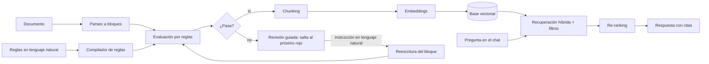

# SDD: Semáforo de calidad documental para RAG

Estado: **v1.0, decisiones cerradas** · 2026-10-11 · Autor: Luciano Balbiano

Documento de diseño del proyecto integrador del laboratorio. Define qué se construye, cómo y
**por qué**, y deja escritas las dudas abiertas antes de tocar código.

**Cambios en v0.2**: costo cero como restricción dura; evaluador propio local en vez de Jev;
LLMs por free tiers con respaldo local; los documentos que no pasan no se indexan; navegación
por errores; temática y reglas propuestas; repo público.

---

## 0. Restricciones del proyecto

1. **Costo cero, o lo más cerca posible.** Es investigación. Todo lo que pueda correr local
   en la MacBook M4 corre local. Lo que necesite un modelo grande va por *free tiers* de APIs,
   con un modelo local como respaldo.
2. **Se entiende cada pieza.** Cada etapa se construye **primero a mano** (la versión mínima
   que muestra el mecanismo) y **después con la librería** que se usa en la industria, y se
   comparan las dos. Ver §1.
3. **Repo público, licencia MIT.** Solo documentos públicos, nada de la entrevista de origen, ninguna clave
   en el código. El corpus se versiona como una lista de URLs más un script de descarga, no
   como archivos.

## 1. Cómo se aprende en este proyecto

El proyecto es la excusa; el objetivo es entender cómo se construye software con LLMs hoy.
Cada lab sigue el mismo recorrido, y su README lo deja escrito:

| Paso | Qué se hace | Ejemplo (base vectorial) |
|---|---|---|
| 1. Concepto | Qué problema resuelve, en una página | Buscar "lo más parecido" entre millones de vectores sin compararlos todos |
| 2. A mano | La versión mínima en Python puro o numpy | Similitud coseno contra todos; después un HNSW de juguete |
| 3. Con la librería | La herramienta real y qué hace por nosotros | Qdrant: índice, filtros, persistencia, cuantización |
| 4. Medición | Un número que compare 2 y 3 | Recall@10 y latencia: exacto vs HNSW vs Qdrant |
| 5. Nota | Qué aprendí, en `notes/` | Cuándo conviene cada una y qué parámetros importan |

Las dependencias entran en el lab donde se usan por primera vez, con una línea sobre qué
resuelven y qué alternativa se descartó.

## 2. El problema

Un buscador semántico (RAG) responde tan bien como lo que tiene indexado. En la práctica:

- La gente sube documentos a diario y no sabe cuáles le van a servir al asistente.
- Hay información que una persona ve y el modelo no: una tabla con fondo oscuro y texto en
  rojo es obvia para un humano y, después de extraer el texto, es un párrafo más (o nada).
- Cuando el asistente contesta mal sobre un documento mal indexado, la culpa cae sobre el
  asistente ("no sirve"), no sobre el documento.

La idea: **evaluar cada documento antes de indexarlo**, mostrar en un semáforo qué partes
están bien (verde), dudosas (amarillo) o mal (rojo), y **guiar a la persona por cada
problema** para corregirlo en lenguaje natural. Un documento entra al índice solo cuando
pasa las reglas.

## 3. Objetivos

### Del producto
1. Subir un documento (`.md`, `.pdf`, `.docx`, `.pptx`, `.html`) y ver el semáforo por bloque
   (párrafo, tabla, título).
2. Las reglas se escriben **en lenguaje natural** y son configurables: 5, 20 o 50, las que
   haga falta. Son datos, no campos fijos.
3. **No se indexa hasta que pasa.** La corrección tiene que ser rápida: la UI salta de un
   problema al siguiente y en cada uno pregunta qué cambiar, en lenguaje natural.
4. Indexar el documento aprobado y conversar con el corpus por chat, con citas.

### De aprendizaje
1. **Bases de datos vectoriales a fondo**: embeddings, distancias, índices (HNSW), filtros
   por metadatos, búsqueda híbrida, cuantización.
2. **Procesamiento de documentos**: de un archivo a bloques con estructura, de bloques a
   chunks, de chunks a vectores, y de vuelta con la recuperación.
3. **Lo que rodea al modelo**: evals, calibración, guardrails, permisos, costo y latencia.
4. **Python profesional**: FastAPI, Pydantic, async, pytest, y entender cada librería.

### No-objetivos (por ahora)
- Multiusuario real, autenticación o despliegue.
- Editar el archivo original. Se guarda la versión corregida en texto estructurado.
- Documentos escaneados (OCR) e imágenes.
- Una UI linda. Tiene que ser simple, rápida y funcionar.

## 4. Flujo de punta a punta



| # | Subsistema | Entrada → salida | Qué se aprende |
|---|---|---|---|
| 1 | Ingesta y parseo | archivo → bloques con tipo, texto, posición y sección | cómo es un PDF por dentro, layout, tablas |
| 2 | Reglas | texto libre → preguntas tipadas, versionadas | salida estructurada, validación, prompts |
| 3 | Evaluador (semáforo) | bloques × reglas → nivel + confianza | logprobs, clasificación, calibración |
| 4 | Revisión guiada | bloque + instrucción → bloque nuevo, re-evaluado | generación controlada, guardrails |
| 5 | Indexación y RAG | bloques aprobados → chunks → vectores → respuestas | embeddings, índices, retrieval, re-ranking, evals |

## 5. Diseño por componente

### 5.1 Ingesta y parseo

**Qué hace.** Convierte el archivo en una lista de **bloques**: la unidad que se evalúa, se
muestra en la UI y se corrige.

```python
class Bloque(BaseModel):
    id: str            # estable entre versiones: doc_id + posición
    tipo: str          # "titulo" | "parrafo" | "tabla" | "lista"
    texto: str         # en markdown; las tablas como tabla markdown
    seccion: list[str] # ruta de títulos: ["Requisitos", "Documentación"]
    pagina: int | None
    estilo: dict       # lo que el texto plano pierde: color, fondo, negrita, resaltado
```

**Herramienta: [Docling](https://github.com/docling-project/docling)** (open source, local,
gratis). Lee PDF, DOCX, PPTX, HTML y MD con un mismo modelo de documento: títulos, tablas
como estructura, orden de lectura y páginas.
- *A mano primero*: PyMuPDF para ver qué hay adentro de un PDF (spans de texto con fuente,
  color y posición). Ahí se entiende por qué "extraer el texto" no es trivial.
- *El caso "texto rojo sobre fondo oscuro"*: el estilo que importa se **escribe en el
  texto** que ve el evaluador y que se indexa: `[resaltado en rojo] Plazo máximo: 10 días`.
  Medir cuánto de eso sobrevive en cada formato es el lab 11.

### 5.2 Reglas configurables en lenguaje natural

Las reglas **son datos, no código**. La persona escribe:

> "Toda tabla con montos tiene que indicar la moneda y desde cuándo rigen."

Un LLM la **compila** a una definición tipada (Pydantic), que una persona revisa y guarda:

```yaml
id: montos-moneda-vigencia
fuente: "ISO 4217; ISO 24495-1 (relevante)"   # la norma de la que sale la regla
version: 1
tipo: semantica             # semantica (la evalúa un modelo) | determinista (código)
alcance: bloque             # bloque | documento
aplica_a: [tabla, parrafo]
pregunta: "¿Los montos del texto indican moneda y fecha desde la que rigen?"
niveles:
  verde: "Indica moneda y fecha de vigencia."
  amarillo: "Indica solo una de las dos, o es ambigua."
  rojo: "Tiene montos sin moneda ni vigencia."
bloqueante: true            # si queda en rojo, el documento no se indexa
ejemplos:
  - texto: "| Trámite | Arancel |\n| DNI | 5000 |"
    esperado: rojo
```

- *Por qué compilar*: la regla queda auditable, versionada y probada con sus ejemplos antes
  de activarse. La descripción del nivel **es la explicación en la UI**, sin generar texto.
- *Reglas deterministas*: "un párrafo no supera las 250 palabras" no necesita un modelo. El
  compilador detecta esos casos y genera un chequeo en código. Es más barato y es exacto.
- *Reglas vagas*: "que sea claro" no es evaluable. El compilador tiene que poder responder
  "esta regla es ambigua, dame un ejemplo de bueno y uno de malo".

### 5.3 Evaluador: el semáforo

**Qué hace.** Para cada bloque y cada regla aplicable devuelve un nivel (verde, amarillo o
rojo) y una confianza. Agrega por bloque y por documento.

**De dónde sale la idea.** [Jev](https://typesafe.ai/blog/introducing-system-one-models-and-jev)
(TypeSafe AI) popularizó los modelos "System One": no generan texto, reciben un estado y
preguntas tipadas (`Choice`, `Score`, `Noul`) y devuelven decisiones con probabilidades
calibradas. Es exactamente la forma del semáforo. Pero Jev es pago y tiene las altas cerradas
desde el 22-sep-2026, así que **no es una dependencia del proyecto**.

**La técnica detrás es simple, y la construimos nosotros.** Un LLM, antes de escribir,
calcula una probabilidad para cada token posible. Si la pregunta termina en
"Respondé A, B o C" y en vez de generar leemos **las probabilidades de los tokens `A`, `B` y
`C`** en una sola pasada del modelo, obtenemos:
- una respuesta que **siempre** es una de las opciones (no hay JSON roto ni texto de más),
- una distribución de probabilidad, de la que sale la confianza,
- una sola pasada hacia adelante: rápido y sin generar.

Esas probabilidades crudas suelen estar mal calibradas (el modelo dice 95 % y acierta el
70 %). Se corrigen con **temperature scaling**: un único parámetro ajustado sobre un set
etiquetado. Es lo que hacen las alternativas open source a Jev
([open-alternative-jev](https://github.com/ikermoel/open-alternative-jev), Von y otras).

```python
class Evaluador(Protocol):
    def evaluar(self, state: str, reglas: list[Regla]) -> dict[str, Veredicto]: ...

class EvaluadorLogprobs:     # propio: mlx-lm + Qwen chico local, lee logprobs de A/B/C
class EvaluadorLibreria:     # una alternativa open source a Jev (Von / so1), para contrastar
class EvaluadorGenerativo:   # LLM por API free tier, JSON validado con Pydantic (línea base)
```

- **Modelo local**: un Qwen de 4B a 8B cuantizado a 4 bits con `mlx-lm` en la M4. No cuesta
  nada y no tiene límites de uso.
- **Contexto del bloque**: el *state* lleva la ruta de títulos, el bloque, y el anterior y
  el siguiente recortados, marcando cuál se evalúa.
- **Agregación**: el bloque toma el peor nivel de sus reglas. Con confianza baja (umbral a
  calibrar) queda **amarillo "dudoso"**, nunca verde. El documento pasa si ningún bloque
  queda rojo en una regla `bloqueante` y se cumplen las reglas de alcance documento.
- **Caché** por hash de (texto del bloque, versión de la regla): re-evaluar después de una
  corrección cuesta un solo bloque.

### 5.4 Revisión guiada

El documento no entra al índice hasta pasar, así que esta pantalla es la más importante del
producto. Tiene que ser **rápida**:

1. Al terminar la evaluación, la UI muestra el documento coloreado y un contador:
   *"4 rojos · 7 amarillos"*.
2. **Salta directo al primer rojo.** Resalta el bloque, muestra qué regla falla y por qué
   (la descripción del nivel) y abre un campo con una pregunta concreta, por ejemplo:
   *"Esta tabla tiene montos sin moneda. ¿En qué moneda están y desde cuándo rigen?"*.
3. La persona contesta en lenguaje natural. Un **LLM generativo** reescribe solo ese bloque
   con la respuesta.
4. El bloque nuevo se **re-evalúa** con sus reglas y con dos guardrails:
   - "¿La reescritura agrega datos que no están ni en el original ni en la respuesta?"
   - "¿Cambia el significado más allá de lo pedido?"
5. Se muestra el antes y el después. **Enter acepta y salta al siguiente problema**; también
   se puede editar o descartar.
6. Atajos de teclado: `n` siguiente, `p` anterior, `Enter` aceptar, `Esc` saltear.
7. Cuando no quedan rojos bloqueantes, aparece **"Indexar"**. Los amarillos se pueden revisar
   o aceptar en bloque.

Se guarda el original, la versión corregida y el historial: qué regla, qué contestó la
persona y qué cambió.

### 5.5 Chunking, embeddings, base vectorial y RAG

**Chunking.** Se parte de los bloques y se respetan los límites de sección. Las tablas no se
cortan; si son largas, se parten por filas repitiendo el encabezado. Tamaño y solapamiento
salen del lab 03. Metadatos de cada chunk:

```python
{"doc_id", "version", "bloque_ids", "seccion", "pagina", "permisos", "fecha_indexado"}
```

**Embeddings (locales, gratis).** Un modelo multilingüe corriendo en la M4: `bge-m3` (da
vectores densos y dispersos), `Qwen3-Embedding-0.6B` o `multilingual-e5`. Se elige en el lab
04 midiendo recall sobre nuestras preguntas.

**Base vectorial: Qdrant en modo local** (`QdrantClient(path="data/qdrant")`), sin servidor ni
Docker. El mismo código funciona después contra un servidor.
- *Por qué*: filtros por metadatos **durante** la búsqueda (justo lo que pide el caso de
  permisos), búsqueda híbrida densa más dispersa, y un cliente Python claro.
- *A mano primero (lab 12)*: búsqueda exacta con numpy, después un HNSW de juguete, después
  Qdrant. Se mide qué se pierde y qué se gana en cada paso.
- *Alternativas que se mencionan en el lab*: pgvector, Chroma, LanceDB.

**Recuperación.**
1. Filtro por permisos. **Va en la base, nunca en el prompt.**
2. Búsqueda híbrida (densa + dispersa) → top-k.
3. Re-ranking con un cross-encoder local (`bge-reranker-v2-m3`) → top-n.
4. Generación con citas a `bloque_ids`. Si el re-ranking no supera un umbral, la respuesta es
   "no tengo esa información".

### 5.6 Modelos generativos a costo cero

Se usan para compilar reglas, reescribir bloques y responder en el chat. Todos los
proveedores elegidos hablan el formato de OpenAI, así que hay **un solo cliente** con una
cadena de respaldo: si uno devuelve 429 (límite), se pasa al siguiente.

| Orden | Proveedor | Modelos candidatos | Límite gratis (aprox., a verificar en la consola) |
|---|---|---|---|
| 1 | Groq | `qwen/qwen3.8-27b`, `openai/gpt-oss-120b` | 30 req/min, 1.000 req/día por modelo |
| 2 | NVIDIA NIM | `gpt-oss-120b`, Nemotron | 40 req/min |
| 3 | Google AI Studio | Gemini Flash | sin límite publicado por modelo |
| 4 | OpenRouter `:free` | lo mejor disponible ese día | 50 req/día |
| 5 | Local, `mlx-lm` | Qwen 8B 4-bit | sin límite, más lento |

- *"El mejor según benchmarks"*: los modelos abiertos que lideran hoy (MiMo-V2.6-Pro,
  GLM-5.3, Kimi K3, Qwen3.8 Max) no tienen free tier estable. Elegimos entre los gratuitos y
  **decidimos con nuestro propio eval** (lab 01): los benchmarks generales no miden
  "reescribir un bloque sin inventar".
- *Cuidado con los free tiers*: algunos pueden usar los prompts para entrenar. No es problema
  porque el corpus es público, pero es otra razón para no meter nunca datos privados.
- Cada respuesta registra qué proveedor y modelo contestó, para poder rastrear cambios de
  calidad.

### 5.7 API e interfaz

**FastAPI** como backend: rutas para documentos, reglas, evaluación, revisión y chat.
Pydantic para todos los contratos, `async` para no bloquear mientras se evalúa, y
Server-Sent Events para mostrar el progreso de la evaluación y la respuesta del chat en
streaming.

Frontend mínimo servido por el mismo FastAPI: **plantillas Jinja más htmx**, con un poco de
JavaScript solo para los atajos de teclado. Tres pantallas: **Reglas**, **Documento** (soltar
archivo, semáforo y revisión guiada) y **Chat**.

## 6. Arquitectura del código

```
src/llm_lab/
  modelos.py        cliente OpenAI-compatible con cadena de free tiers + local
  parseo/           archivo → bloques (PyMuPDF a mano, Docling)
  reglas/           compilador, esquema Pydantic, almacenamiento versionado
  evaluacion/       Evaluador (Protocol), logprobs local, librería, generativo; calibración
  revision/         reescritura + guardrails + diff
  indice/           chunking, embeddings, Qdrant
  rag/              recuperación, re-ranking, generación con citas
  evals/            métricas: accuracy, ECE, recall@k, MRR, fidelidad
app/                FastAPI + plantillas Jinja/htmx
corpus/             urls.txt + descargar.py (los archivos no se versionan)
labs/NN-*/          un experimento por carpeta que usa src/llm_lab
```

Persistencia: **SQLite** para documentos, versiones, reglas y resultados; Qdrant local para
vectores.

## 7. Temática y reglas propuestas

### Temática: guías de trámites y servicios públicos en español (decidida)
Documentos de organismos públicos que explican cómo hacer un trámite: requisitos, aranceles,
plazos y pasos. Por ejemplo, guías de trámites de un registro civil, de una agencia de
recaudación o de un organismo de seguridad social, en PDF, DOCX y HTML.
- *Por qué esta*: son públicos y en español; tienen tablas de montos, plazos y advertencias
  resaltadas en color (el caso de origen); quedan desactualizados seguido (la vigencia
  importa); y es fácil escribir preguntas con una respuesta única y verificable para las
  evals.
- *Alternativas*: manuales de producto (advertencias en rojo, tablas técnicas) o normativa
  de protección de datos (texto denso, mucha estructura).

### Reglas: derivadas de estándares

Las reglas no son opinión: cada una cita la norma de la que sale (campo `fuente` en la
definición de la regla). Así el semáforo es defendible ("esto incumple WCAG 1.4.1") y otra
temática puede cargar sus propias normas con el mismo mecanismo.

**Normas de base**
- **WCAG 2.2** (W3C, gratuita): accesibilidad de contenido. Sus niveles A, AA y AAA dan una
  severidad que no inventamos nosotros.
- **ISO 24495-1:2023**, lenguaje claro. Cuatro principios: el lector encuentra lo que
  *necesita* (relevante), *dónde* está (encontrable), lo *entiende* (comprensible) y lo puede
  *usar* (utilizable). La norma es paga; trabajamos con sus principios publicados y con las
  guías de la Red Panhispánica de Lenguaje Claro.
- **Normas de lenguaje claro aplicables al corpus**: Ley 15.184 (Provincia de Buenos Aires)
  y Ley 6.367 (Ciudad de Buenos Aires). Obligan a esos organismos a escribir claro, así que
  evaluarlos contra esto tiene sentido.
- **ISO 4217** (códigos de moneda), **ISO 8601** (fechas inequívocas) y **Dublin Core**
  (metadatos mínimos de un documento: emisor, fecha, título).

**Criterio de severidad**
- **Bloqueante (rojo)**: criterios WCAG de nivel A, e integridad de datos (moneda, fechas,
  vigencia, emisor). Si se incumplen, el documento informa mal o excluye a alguien.
- **No bloqueante (amarillo)**: WCAG AA y AAA, y las pautas de redacción de ISO 24495.
  Mejoran la calidad, pero no traban la indexación.

| # | Regla | Fuente | Tipo | Alcance | Severidad |
|---|---|---|---|---|---|
| R1 | La información no depende solo del color o del formato: lo resaltado se dice en el texto | WCAG 1.4.1 (A) | semántica | bloque | bloqueante |
| R2 | Las tablas tienen encabezados y cada celda se entiende con su fila y columna (sin "ídem" ni celdas vacías con significado) | WCAG 1.3.1 (A) | semántica | bloque | bloqueante |
| R3 | Los enlaces dicen a dónde llevan (no "hacé clic acá") | WCAG 2.4.4 (A) | semántica | bloque | bloqueante |
| R4 | Los títulos describen el contenido de su sección | WCAG 2.4.6 (AA) | semántica | bloque | no bloqueante |
| R5 | Las siglas tienen su forma completa la primera vez | WCAG 3.1.4 (AAA) | semántica | documento | no bloqueante |
| R6 | Todo monto indica la moneda de forma inequívoca | ISO 4217 | semántica | bloque | bloqueante |
| R7 | Las fechas son absolutas e inequívocas (no "el mes próximo" ni "03/04" sin año) | ISO 8601 | semántica | bloque | bloqueante |
| R8 | Montos, aranceles y plazos indican desde cuándo rigen | ISO 24495-1, relevante | semántica | bloque | bloqueante |
| R9 | El documento identifica al organismo emisor y la fecha de publicación o actualización | Dublin Core (publisher, date) | semántica | documento | bloqueante |
| R10 | El documento dice al principio para quién es y para qué sirve | ISO 24495-1, relevante | semántica | documento | no bloqueante |
| R11 | Los pasos del trámite están numerados y en orden; los requisitos, en lista | ISO 24495-1, encontrable | semántica | bloque | no bloqueante |
| R12 | Palabras conocidas; los términos técnicos o jurídicos se explican | ISO 24495-1, comprensible | semántica | bloque | no bloqueante |
| R13 | Oraciones y párrafos concisos (umbral inicial: 30 palabras por oración, 150 por párrafo) | ISO 24495-1, comprensible | determinista | bloque | no bloqueante |
| R14 | Se dirige al lector en voz activa ("presentá el DNI", no "deberá ser presentado") | ISO 24495-1, comprensible | semántica | bloque | no bloqueante |

**Lo que no es una regla.** Que un chunk se entienda fuera de contexto ("ver arriba") es un
problema del RAG, no de quien escribe, y no lo exige ninguna norma. Se resuelve en el
chunking: cada chunk lleva antepuesta su ruta de títulos (§5.5). El contenido de relleno
(índices, pies de página repetidos) tampoco es una regla: se excluye en el parseo.

## 8. Evals: cómo sabemos que funciona

Si no se mide, no se concluye. Cada subsistema tiene su número.

### 8.1 Evaluador (el corazón)
- **Set dorado**: unos 300 bloques del corpus, etiquetados a mano contra las reglas R1–R14.
  Se separan en ajuste (para calibrar) y prueba.
- **Métricas**: accuracy y matriz de confusión por regla. La que importa es **recall de rojo**:
  se prefiere un amarillo de más a un rojo que pasa como verde.
- **Calibración**: ECE y diagrama de confiabilidad, antes y después del temperature scaling.
  ¿Cuando dice 90 %, acierta el 90 % de las veces?
- **Comparación**: logprobs local (4B vs 8B) vs alternativa open source vs LLM generativo por
  API, en calidad, latencia p50/p95 y costo (que debería ser cero en todos).

### 8.2 Compilador de reglas
Unas 30 reglas escritas a mano con su compilación de referencia. ¿Cuántas compila bien sin
edición? ¿Cuántas pasan sus propios ejemplos? ¿Detecta las vagas?

### 8.3 Revisión guiada
¿El bloque corregido pasa a verde? ¿Cuántas reescrituras **inventan datos**? Se mide con
respuestas trampa que no contienen el dato pedido.

### 8.4 Recuperación y respuesta
- Set fijo de unas 50 preguntas con su pasaje correcto: **recall@k y MRR** (labs 03–05).
- Fidelidad (cada afirmación respaldada por un chunk citado), citas correctas y tasa de
  "no lo sé" cuando corresponde (labs 06–07).
- Las métricas se implementan primero a mano. Ragas se usa al final como contraste.

### 8.5 La hipótesis del proyecto
> **Corregir con el semáforo antes de indexar mejora las respuestas del RAG.**

El mismo corpus indexado (A) tal cual y (B) después de la revisión guiada, con las mismas 50
preguntas. Se compara exactitud y fidelidad. **Es el número que justifica el producto.**

## 9. Guardrails y seguridad

| Riesgo | Mitigación |
|---|---|
| **Prompt injection dentro de documentos** ("ignorá tus instrucciones…") | Los documentos son datos no confiables: van delimitados en el prompt, hay una regla de detección en la ingesta, y el modelo nunca tiene herramientas con efectos. |
| Jailbreak en el chat | Clasificador de entrada (el mismo evaluador por logprobs, pregunta sí/no) antes de recuperar. |
| Fuga entre permisos | Filtro en Qdrant. Test automático: un usuario sin permiso nunca recibe un chunk ajeno. |
| Respuesta sin evidencia | Umbral de re-ranking, y si no se supera, "no tengo esa información". |
| Reescritura que inventa | Guardrails de §5.4 más el antes y después con aceptación humana. |
| Límites de free tier | Cadena de proveedores, caché, y respaldo local. |
| Claves en un repo público | `.env` fuera de git, `.env.example` sin valores, y revisar el historial antes de publicar. |

## 10. Plan de labs

Los labs 01–10 del README son la base. Los nuevos aplican esa base al proyecto.

| # | Lab | La pregunta | Se aprende |
|---|---|---|---|
| 11 | Parseo de documentos | PyMuPDF vs Docling: ¿cuánta estructura (tablas, títulos, estilos) sobrevive en PDF, DOCX y MD? | formatos, layout, extracción |
| 12 | Base vectorial a fondo | numpy exacto vs HNSW propio vs Qdrant: ¿cuánto recall se pierde por velocidad? ¿Cómo afectan los filtros? | índices ANN, distancias, filtros |
| 13 | Decisiones por logprobs | Leer las probabilidades de A/B/C vs pedir un JSON: ¿cuál acierta más, cuál está mejor calibrado, cuánto mejora el temperature scaling? | logits, clasificación, calibración |
| 14 | Reglas en lenguaje natural | ¿Cuántas reglas compila bien un LLM sin intervención humana? | salida estructurada, Pydantic |
| 15 | Revisión guiada | ¿Cuántas reescrituras pasan a verde sin inventar datos? | generación controlada, guardrails |
| 16 | App y experimento final | ¿Corregir antes de indexar mejora las respuestas? | FastAPI, integración, eval de punta a punta |

**Orden sugerido**: 01 → 02 → 11 → 03 → 04 → 12 → 05 → 13 → 14 → 15 → 06 → 07 → 10 → 16
(08 y 09 quedan opcionales). El primer entregable mostrable llega al terminar el 13: parseo,
semáforo y una pantalla mínima.

## 11. Riesgos

1. **Límites de los free tiers.** Cambian sin aviso. Se mitiga con la cadena de proveedores,
   la caché y el modelo local.
2. **Memoria de la M4 (24 GB).** Un 8B en 4 bits ocupa unos 5 GB; con embeddings y
   re-ranker entra con margen. Un modelo de más de 14B ya compite con el resto del sistema.
3. **El problema original es en parte de parseo.** Si el extractor pierde el texto rojo,
   ningún evaluador lo va a ver. Por eso el lab 11 va antes que el semáforo.
4. **Reglas vagas.** Se mitiga con el compilador que pide ejemplos.
5. **Fricción.** Como no se indexa hasta pasar, una revisión lenta mata el producto. La
   revisión guiada (§5.4) y las reglas no bloqueantes existen por eso.
6. **Alcance.** Son cinco subsistemas. Cada lab es entregable por sí mismo.

## 12. Decisiones cerradas (2026-10-11)

1. **Corpus**: guías de trámites de la Provincia y la Ciudad de Buenos Aires (leyes 15.184 y
   6.367), en los formatos en que se publiquen (PDF, DOCX, HTML).
2. **Reglas**: R1–R14 de §7, con su criterio de severidad (WCAG A e integridad de datos
   bloquean).
3. **Umbrales de R13**: 30 palabras por oración y 150 por párrafo, a ajustar con datos.
4. **Licencia**: MIT. Repo público.
